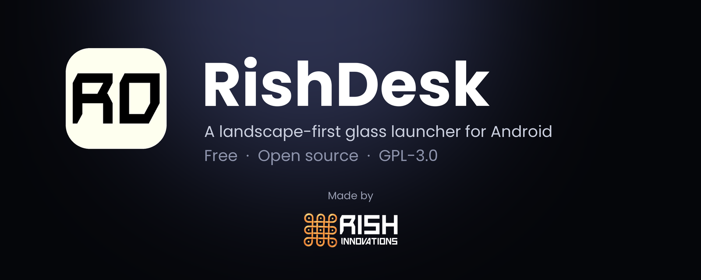

<p align="center">
  
</p>

<p align="center">
  <a href="https://github.com/engineerharish05/Rish-Desk/releases/latest"></a>
  <a href="https://github.com/engineerharish05/Rish-Desk/actions/workflows/build.yml"></a>
  <a href="LICENSE"></a>
  
  
</p>

**RishDesk** is a free, open-source Android launcher with a desktop-style, landscape-first layout and a frosted-glass interface. It replaces your home screen with a grid, a dock, an app drawer and a status bar, and it works with both gesture and 3-button navigation.

- No ads, no accounts, no tracking. The app does not even request the internet permission. See the [privacy policy](docs/PRIVACY.md).
- Made by [Rish Innovations](#about) and released under GPL-3.0.

## Download

1. Open the [latest release](https://github.com/engineerharish05/Rish-Desk/releases/latest).
2. Download `RishDesk-<version>.apk` (the `.sha256` file lets you verify it).
3. Open the APK on your phone and allow installation from your browser or file manager if Android asks.
4. Press the Home button and choose **RishDesk**, then **Always**.

To go back to your old launcher: **Settings → Apps → Default apps → Home app**. The dock's **Exit** tile also opens the chooser.

Prefer automatic updates? Add this repository to [Obtainium](https://obtainium.imranr.dev/) and it will install new releases straight from GitHub.

**Requirements:** Android 8.0 (API 26) or later. Developed and tested on a Realme C61 running Android 16; behaviour on other devices can differ, so please [report problems](https://github.com/engineerharish05/Rish-Desk/issues/new/choose).

## Features

| Area | What you get |
| --- | --- |
| Home | Configurable grid (default 5 × 4), drag-and-drop shortcuts, folders, custom labels, resizable widgets, edit mode |
| App drawer | 5 × 3 paged grid, live search by name or package, A to Z order, All / Favorites filters, favorites, hide and restore apps, long-press menu (add to Home or dock, app info, uninstall) |
| Dock | Pinned apps, reorderable, adjustable size and alignment, USB OTG tile, launcher chooser |
| Look | Frosted-glass surfaces, accent colour, glass opacity, animations, branded opening screen |
| Wallpaper | Pick a photo, drag and pinch to frame it, tap Set. Dim and blur options |
| Settings | Sectioned pages (Appearance, Wallpaper, Desktop, App drawer, Dock, Widgets, Keyboard, Devices, System, Reset, Privacy) |
| Keyboard | Ctrl, Alt or Meta + D, F, /, comma, H, 1 to 9, plus Esc, arrows, Tab and Enter |
| Extras | Optional "open apps in landscape" (needs the Modify system settings permission), shortcuts to Wi-Fi, Bluetooth, Display, Storage and more |

### Keyboard shortcuts

Enabled by default; turn them off in **Settings → Keyboard**.

| Shortcut | Action |
| --- | --- |
| `Ctrl/Alt/Meta + D`, `F` or `/` | Open the app drawer and focus search |
| `Ctrl/Alt/Meta + ,` | Open settings |
| `Ctrl/Alt/Meta + H` | Go home |
| `Ctrl/Alt/Meta + 1…9` | Launch the dock app in that position |
| `Esc` | Go back |

### Limits you should know about

Android does not allow a launcher to do some things, so RishDesk does not pretend to:

- It cannot force portrait-only apps into landscape (the optional landscape setting only helps apps that can rotate).
- It cannot show a taskbar of running apps or act as a full file manager. It offers Files and Storage shortcuts instead.
- Shortcuts cannot yet be dragged between home pages.
- There is no light theme yet.

See [CHANGELOG.md](CHANGELOG.md) and the [roadmap](FEATURE_ROADMAP.md) for what is next.

## Build from source

Requirements: JDK 17 and Android SDK platform 35.

```bash
git clone https://github.com/engineerharish05/Rish-Desk.git
cd Rish-Desk
chmod +x ./gradlew
./gradlew testDebugUnitTest assembleDebug
```

The APK is written to `app/build/outputs/apk/debug/RishDesk-debug.apk`. You can also open the folder in Android Studio and run the `app` configuration.

Every push and pull request is built and tested by [GitHub Actions](.github/workflows/build.yml). Pushing a version tag such as `v1.1.0` runs the [release workflow](.github/workflows/release.yml), which signs the APK and publishes a GitHub Release.

## Project layout

```text
app/src/main/java/com/rishdeskdroid/app/
├── MainActivity.kt        entry point, keyboard shortcuts, navigation
├── data/                  preferences, app list, wallpaper, widgets, status
└── ui/                    home, drawer, dock, settings, glass components, opening screen
```

The Kotlin package and application ID are `com.rishdeskdroid.app`. They are kept from earlier builds so that updates install over existing installs and keep their settings. See [docs/REPOSITORY_STRUCTURE.md](docs/REPOSITORY_STRUCTURE.md) for details.

## Contributing

Contributions are welcome. Please read [CONTRIBUTING.md](CONTRIBUTING.md) and the [Code of Conduct](CODE_OF_CONDUCT.md), then open an [issue](https://github.com/engineerharish05/Rish-Desk/issues/new/choose) or a pull request. Security problems should be reported privately; see [SECURITY.md](SECURITY.md).

## License

Copyright (c) 2026 Harish P and Rish Innovations. RishDesk is licensed under the **GNU General Public License v3.0 only**; see [LICENSE](LICENSE). Third-party libraries keep their own licenses.

The RishDesk and Rish Innovations names and logos are not covered by the GPL. You may redistribute the software under the GPL, but please do not use the names or logos to suggest that a modified version is the official one.

## About

<p align="center">
  
</p>

RishDesk is designed and built by **Harish P** at **Rish Innovations**, Chennai, India. Implementation was assisted by AI tools.
